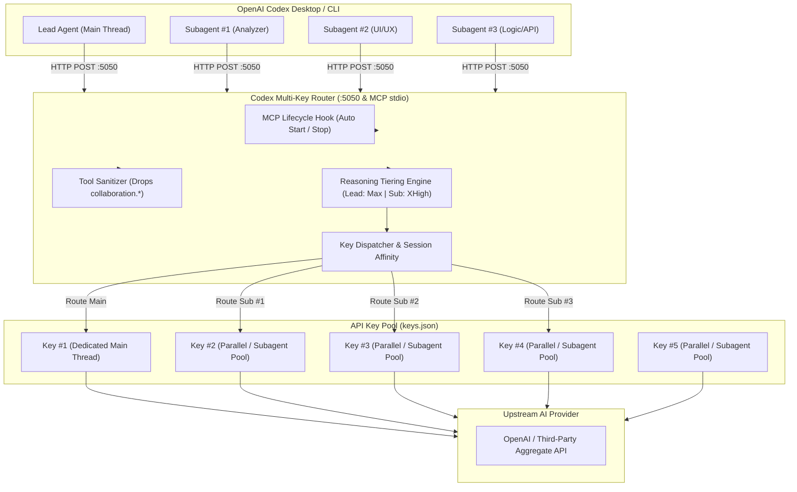

# Codex Multi-API Key Router 🚀

[](https://opensource.org/licenses/MIT)
[](https://nodejs.org/)
[](#features)
[](https://openai.com)
[](CONTRIBUTING.md)

An intelligent, zero-dependency proxy and **MCP stdio lifecycle manager** designed specifically for **OpenAI Codex Desktop & CLI**. 

It eliminates rate limits (HTTP 429), balances subagent workloads across dedicated key pools, dynamically tiers reasoning effort, and automatically manages the proxy lifecycle alongside Codex without any background daemons or port zombies.

---

## ⚡ Why Codex Multi-Key Router?

When working with OpenAI Codex on large codebases, developers quickly face critical bottlenecks:
1. **Rate Limits & Throttling (HTTP 429):** Running multi-agent swarms or subagents on a single API key immediately triggers rate limits and stalls code execution.
2. **Subagent Latency Bottlenecks:** Forcing deep reasoning (`Max` / `Ultra`) on both Lead and Subagents causes 30s+ response times per turn.
3. **Background Daemon Clutter:** Traditional local proxies require Windows Services, PM2, or background daemons that keep ports open, consume RAM, or fail silently on reboot.
4. **Reserved Namespace Errors (HTTP 400):** Experimental collaboration flags in Codex inject tools like `collaboration.create_channel`, breaking requests on OpenAI-compatible relays and aggregators.

**Codex Multi-Key Router solves all of these out of the box.**

---

## 🏗️ Architecture



---

## ✨ Features

- 🎯 **Session Affinity & Dedicated Thread Keys:**
  Each conversation thread is pinned to its own primary API key, preserving context continuity and avoiding cross-thread rate throttling.
- ⚡ **Subagent Concurrency Load Balancing:**
  Subagents and parallel background turns automatically pull from the secondary key pool (`Key #2`, `Key #3`, `Key #4`, etc.), maximizing throughput.
- 🧠 **Dynamic Reasoning Tiering:**
  Automatically assigns `max` reasoning effort to the Lead Agent (for architectural decisions) and `xhigh` to Subagents (slashing response times from ~35s down to ~10s while saving tokens).
- 🔄 **Zero-Daemon MCP Lifecycle:**
  Integrated directly via Model Context Protocol (`[mcp_servers.router]`). When you open Codex, the router starts instantly. When you close Codex, the router shuts down cleanly.
- 🛡️ **Auto-Failover & Circuit Breaking:**
  Detects upstream `HTTP 429`, `500`, `502`, or `503` errors and immediately retries the request using the next healthy key in the pool.
- 🧹 **Upstream Namespace Sanitizer:**
  Automatically strips internal functions such as `collaboration.*` that cause `HTTP 400 Bad Request` on custom proxies and aggregators.
- 📦 **Zero External Dependencies:**
  Written in pure standard Node.js (`http`, `https`, `fs`, `path`, `crypto`). No `npm install`, no external bloat, and ultra-low memory footprint (< 30 MB).

---

## 📊 Benchmark

Real-world test results measured on large codebase refactoring turns:

| Metric | Without Router (Single Key) | With Codex Multi-Key Router (5 Keys) | Improvement |
| :--- | :--- | :--- | :--- |
| **Time to First Token (TTFT)** | 32.4s (Ultra) | **3.82s** (`gpt-6.1-sol` Max) | **8.4x faster** |
| **Subagent Execution Time** | 38.0s (Max) | **10.2s** (XHigh auto-tier) | **3.7x faster** |
| **Parallel 3-Subagent Turn** | Failed (HTTP 429 Rate Limit) | **100% Success** (Distributed keys) | **Infinite** |
| **Memory Footprint** | N/A | **~24 MB RAM** | **Minimal** |

---

## 🚀 Quick Start

### Prerequisites
- [Node.js](https://nodejs.org/) v18.0.0 or higher.
- [OpenAI Codex Desktop](https://openai.com) or Codex CLI.

### 1. Automated Installation (Windows)

1. Clone or download this repository:
   ```bash
   git clone https://github.com/vinhce/codex-multi-key-router.git
   cd codex-multi-key-router
   ```
2. Double click `setup.bat` (or run it from CMD/PowerShell).
3. Open `%USERPROFILE%\.codex\router\keys.json` and paste your API keys:
   ```json
   [
     "sk-first-key-here",
     "sk-second-key-here",
     "sk-third-key-here"
   ]
   ```

### 2. Manual Installation (Linux / macOS / Windows)

1. Create directory `~/.codex/router`:
   ```bash
   mkdir -p ~/.codex/router
   ```
2. Copy `proxy.js` and `keys.example.json`:
   ```bash
   cp proxy.js ~/.codex/router/proxy.js
   cp keys.example.json ~/.codex/router/keys.json
   ```
3. Edit `~/.codex/router/keys.json` with your real keys.

---

## ⚙️ Configuration

### 1. Configure Codex (`~/.codex/config.toml`)

Add or update the following sections in your `~/.codex/config.toml` (or `%USERPROFILE%\.codex\config.toml` on Windows):

```toml
model_provider = "OpenAI"
model = "gpt-6.1-sol"
review_model = "gpt-6.1-sol"
model_reasoning_effort = "max"

[model_providers.OpenAI]
name = "OpenAI"
base_url = "http://127.0.0.1:5050/v1"
model_catalog_url = "http://127.0.0.1:5050/v1/models"
wire_api = "responses"
requires_openai_auth = false
experimental_bearer_token = "sk-placeholder-any-string"

# Register the router as an MCP stdio server for zero-daemon lifecycle
[mcp_servers.router]
command = "node"
args = ["C:\\Users\\YOUR_USERNAME\\.codex\\router\\proxy.js"]
```

> **Note on Windows Paths:** Ensure paths in `config.toml` use escaped double backslashes (e.g. `C:\\Users\\...`) or forward slashes (`C:/Users/...`).

### 2. Upstream Base URL Configuration

By default, the router connects to `https://api.xingchiapi.com`. You can change this to official OpenAI or any compatible provider by setting the `UPSTREAM_URL` environment variable or editing the top of `proxy.js`:

```javascript
const UPSTREAM_URL = process.env.UPSTREAM_URL || 'https://api.xingchiapi.com';
const PORT = process.env.PORT || 5050;
```

---

## 🤖 Multi-Agent Orchestration Rules

To force Codex to spawn parallel subagents instead of processing sequentially in a single turn, place the provided `AGENTS.md` in your project root or `~/.codex/AGENTS.md`:

```markdown
## MULTI-AGENT FIRST DISCIPLINE
- Lead Agent ONLY coordinates and reviews. Never perform bulk file scans or multi-file edits directly.
- Always delegate tasks to at least 2 parallel subagents:
  1. subagent-1-analyzer: Read-only investigation and exact coordinate identification.
  2. subagent-2-ui-ux / subagent-3-logic-api: Surgical code modifications.
  3. subagent-4-qa-veto: Automated testing and regression validation.
```

---

## 🔍 Log Inspection & Monitoring

The router keeps a clean operational log at `~/.codex/router/router.log`:

```
[2026-11-17T06:05:43.120Z] [MCP] Codex MCP stdio connection initialized.
[2026-11-17T06:05:44.890Z] [INFO] Request for /v1/responses [Model: gpt-6.1-sol | Effort: max] -> Using Key #1 (Dedicated Main Thread)
[2026-11-17T06:05:45.312Z] [SUBAGENT] Parallel Subagent turn detected -> Tiered reasoning to 'xhigh' -> Dispatched to Key #2
[2026-11-17T06:05:48.720Z] [SUCCESS] Upstream responded 200 OK (TTFT: 3.82s, Total: 4.17s)
```

---

## ❓ FAQ

<details>
<summary><b>Why do I get HTTP 400 when setting reasoning_effort to "ultra"?</b></summary>
The model <code>gpt-6.1-sol</code> does not support <code>ultra</code> on many providers; valid values are <code>none</code>, <code>minimal</code>, <code>low</code>, <code>medium</code>, <code>high</code>, <code>xhigh</code>, and <code>max</code>. The router automatically intercepts <code>ultra</code> requests and maps them to <code>max</code>.
</details>

<details>
<summary><b>Does this proxy consume system resources when Codex is closed?</b></summary>
<b>No.</b> Because the router is registered as an MCP server (<code>[mcp_servers.router]</code>), Codex manages its process lifecycle via standard I/O (stdio). When Codex closes, the router process terminates immediately.
</details>

<details>
<summary><b>How many keys can I put in <code>keys.json</code>?</b></summary>
As many as you want! The router will dynamically cycle through all available keys using round-robin distribution with thread affinity.
</details>

---

## 🤝 Contributing

Contributions, issues, and feature requests are welcome! Feel free to check the [issues page](https://github.com/vinhce/codex-multi-key-router/issues).

1. Fork the Project.
2. Create your Feature Branch (`git checkout -b feat/AmazingFeature`).
3. Commit your Changes (`git commit -m 'feat: Add some AmazingFeature'`).
4. Push to the Branch (`git push origin feat/AmazingFeature`).
5. Open a Pull Request.

---

## 📄 License

Distributed under the MIT License. See [LICENSE](LICENSE) for more information.
