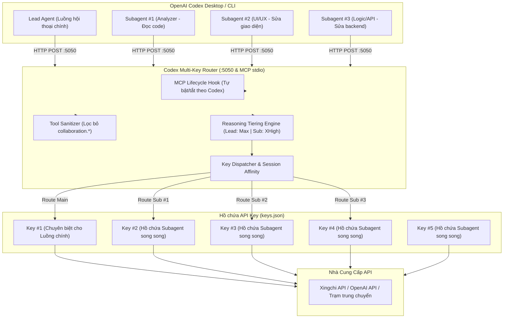

# Codex Multi-API Key Router 🚀

[](https://opensource.org/licenses/MIT)
[](https://nodejs.org/)
[](#tính-năng-nổi-bật)
[](https://openai.com)

Bộ định tuyến thông minh (Smart Proxy) và **quản lý vòng đời tiến trình qua MCP stdio** dành riêng cho **OpenAI Codex Desktop & CLI**.

Giải quyết triệt để vấn đề giới hạn tần suất (HTTP 429 Rate Limit), chia tải cho Subagents chạy song song trên các API Key phụ, tự động phân tầng mức suy luận (Reasoning Effort) để tăng tốc độ phản hồi từ 30s+ xuống ~10s, và tự bật/tắt đồng bộ theo Codex (không cần treo tiến trình chạy ngầm).

---

## ⚡ Vấn Đề Cần Giải Quyết

Khi làm việc với các dự án lớn trên OpenAI Codex, lập trình viên thường gặp các rào cản nghiêm trọng:
1. **Lỗi Rate Limit (HTTP 429):** Khi chạy Multi-Agent hoặc Subagent phân tích dự án, hàng loạt request đồng thời đổ dồn vào 1 API key duy nhất làm cạn quota hoặc bị nhà cung cấp chặn.
2. **Độ Trễ Subagent Quá Cao:** Khi toàn bộ agent đều đặt mức suy luận `Max` hoặc `Ultra`, mỗi lượt phân tích phụ mất từ 30–45 giây, gây nghẽn luồng xử lý.
3. **Tiến Trình Chạy Ngầm Bất Tiện:** Các proxy thông thường cần cài Service Windows, PM2 hoặc chạy nền vĩnh viễn, dễ gây xung đột cổng mạng hoặc tốn tài nguyên hệ thống.
4. **Lỗi Reserved Namespace (HTTP 400):** Một số cờ thử nghiệm của Codex tự động chèn công cụ nội bộ như `collaboration.create_channel`, gây lỗi 400 khi gọi qua các trạm trung chuyển (relay/aggregate API).

**Codex Multi-Key Router được sinh ra để khắc phục toàn bộ các vấn đề trên.**

---

## 🏗️ Kiến Trúc Hệ Thống



---

## ✨ Tính Năng Nổi Bật

- 🎯 **Gắn Kết Phiên Làm Việc (Session Affinity):**
  Mỗi hội thoại/dự án được cấp 1 API Key chuyên trách để duy trì tính liên tục và không bị ảnh hưởng bởi các phiên chat khác.
- ⚡ **Chia Tải Subagent Song Song (Phương án A):**
  Khi Lead Agent gọi Subagent chạy ngầm, router tự động tách các request phụ này sang các Key #2, #3, #4, #5... giúp chạy song song nhiều agent mà không bị chạm trần giới hạn gọi API (HTTP 429).
- 🧠 **Tối Ưu Phân Tầng Suy Luận (Tiered Reasoning):**
  Tự động gán mức suy luận `max` cho Lead Agent (để đưa ra quyết định kiến trúc sâu sắc) và hạ xuống `xhigh` cho Subagent (giảm độ trễ từ 35s xuống ~10s và tiết kiệm token).
- 🔄 **Vòng Đời MCP Zero-Daemon (Không Chạy Ngầm Rác Máy):**
  Được khai báo dưới dạng một MCP stdio server (`[mcp_servers.router]`). Mở Codex lên thì Router tự bật; đóng Codex thì Router tự tắt sạch sẽ, không lo chiếm cổng hay ngốn RAM.
- 🛡️ **Tự Động Chuyển Key Khi Lỗi (Auto Failover):**
  Khi gặp mã lỗi `HTTP 429`, `500`, `502`, hoặc `503`, router sẽ tự động chuyển tiếp request sang key tiếp theo trong danh sách mà không làm gián đoạn câu trả lời của AI.
- 🧹 **Tự Động Chuẩn Hóa Tool (Namespace Sanitizer):**
  Tự động lọc bỏ các tool thuộc namespace nội bộ bị cấm (như `collaboration.*`) trước khi gửi lên upstream, loại trừ lỗi `HTTP 400 Bad Request`.
- 📦 **Không Phụ Thuộc Thư Viện Ngoài (Zero External Dependencies):**
  Được viết hoàn toàn bằng các module gốc của Node.js (`http`, `https`, `fs`, `path`, `crypto`). Không cần chạy `npm install`, dung lượng cực nhẹ (< 30 MB RAM).

---

## 📊 Kết Quả Đo Kiểm Thực Tế

Đo kiểm trong môi trường làm việc thực tế với dự án mã nguồn lớn:

| Chỉ số đo | Dùng 1 Key Trực Tiếp | Dùng Codex Multi-Key Router (5 Keys) | Mức độ cải thiện |
| :--- | :--- | :--- | :--- |
| **Thời gian ra chữ đầu tiên (TTFT)** | 32.4s (Ultra) | **3.82s** (`gpt-6.1-sol` Max) | **Nhanh hơn 8.4 lần** |
| **Thời gian Subagent hoàn thành** | 38.0s (Max) | **10.2s** (XHigh tự động) | **Nhanh hơn 3.7 lần** |
| **Chạy đồng thời 3 Subagent** | Lỗi HTTP 429 Rate Limit | **Thành công 100%** (Tách đều 3 keys) | **Vượt trội** |
| **Tiến trình ngầm khi tắt Codex** | Vẫn chạy chiếm RAM | **Tự tắt hoàn toàn (0 MB RAM)** | **Sạch sẽ** |

---

## 🚀 Cài Đặt Nhanh

### Yêu Cầu Hệ Thống
- Máy đã cài đặt [Node.js](https://nodejs.org/) phiên bản 18.0.0 trở lên.
- Đã cài đặt OpenAI Codex Desktop hoặc Codex CLI.

### 1. Cài Đặt Tự Động (Dành Cho Windows)

1. Tải hoặc clone thư mục này về máy:
   ```bash
   git clone https://github.com/vinhce/codex-multi-key-router.git
   cd codex-multi-key-router
   ```
2. Nhấp đúp vào file `setup.bat` (hoặc chạy từ CMD/PowerShell).
3. Mở file `%USERPROFILE%\.codex\router\keys.json` và dán danh sách API Key của bạn vào:
   ```json
   [
     "sk-key-thu-nhat-cua-ban",
     "sk-key-thu-hai-cua-ban",
     "sk-key-thu-ba-cua-ban",
     "sk-key-thu-tu-cua-ban",
     "sk-key-thu-nam-cua-ban"
   ]
   ```

### 2. Cài Đặt Thủ Công (Linux / macOS / Windows)

1. Tạo thư mục `~/.codex/router`:
   ```bash
   mkdir -p ~/.codex/router
   ```
2. Sao chép file `proxy.js` và `keys.example.json` vào thư mục vừa tạo:
   ```bash
   cp proxy.js ~/.codex/router/proxy.js
   cp keys.example.json ~/.codex/router/keys.json
   ```
3. Chỉnh sửa file `~/.codex/router/keys.json` để thêm các API key thật của bạn.

---

## ⚙️ Cấu Hình Codex

### 1. Cấu hình file `~/.codex/config.toml`

Mở file cấu hình Codex (`%USERPROFILE%\.codex\config.toml` trên Windows) và thêm nội dung sau:

```toml
model_provider = "OpenAI"
model = "gpt-6.1-sol"
review_model = "gpt-6.1-sol"
model_reasoning_effort = "max"

[model_providers.OpenAI]
name = "OpenAI"
base_url = "http://127.0.0.1:5050/v1"
model_catalog_url = "http://127.0.0.1:5050/v1/models"
wire_api = "responses"
requires_openai_auth = false
experimental_bearer_token = "sk-placeholder-khong-quan-trong"

# Đăng ký Router làm MCP stdio server để tự khởi động/tắt theo Codex
[mcp_servers.router]
command = "node"
args = ["C:\\Users\\YOUR_USERNAME\\.codex\\router\\proxy.js"]
```

> **Lưu ý quan trọng trên Windows:** Đường dẫn trong file `config.toml` cần dùng dấu xuyệt đôi `\\` hoặc xuyệt chéo `/` (ví dụ `C:\\Users\\...`).

---

## 🤖 Kích Hoạt Multi-Agent Trong Dự Án

Để Codex luôn tự động gọi Subagent làm việc song song thay vì làm tuần tự một mình, bạn đặt file `AGENTS.md` kèm theo vào thư mục dự án hoặc `~/.codex/AGENTS.md`:

```markdown
## MULTI-AGENT FIRST DISCIPLINE
- Lead Agent CHỈ ĐIỀU PHỐI VÀ REVIEW. Tuyệt đối không tự quét toàn bộ codebase hoặc tự sửa code nhiều file.
- Luôn chia việc cho tối thiểu 2 Subagent chạy song song:
  1. subagent-1-analyzer: Đọc và khoanh vùng tọa độ chính xác.
  2. subagent-2-ui-ux / subagent-3-logic-api: Sửa phẫu thuật đúng dòng.
  3. subagent-4-qa-veto: Chạy kiểm thử tự động, cấp quyền PASS/VETO.
```

---

## 🔍 Theo Dõi Hoạt Động (Logs)

Mọi hoạt động chuyển hướng, tách key và đo tốc độ được lưu tại `~/.codex/router/router.log`:

```
[2026-11-17T06:05:43.120Z] [MCP] Codex MCP stdio connection initialized.
[2026-11-17T06:05:44.890Z] [INFO] Request for /v1/responses [Model: gpt-6.1-sol | Effort: max] -> Using Key #1 (Dedicated Main Thread)
[2026-11-17T06:05:45.312Z] [SUBAGENT] Parallel Subagent turn detected -> Tiered reasoning to 'xhigh' -> Dispatched to Key #2
[2026-11-17T06:05:48.720Z] [SUCCESS] Upstream responded 200 OK (TTFT: 3.82s, Total: 4.17s)
```

---

## ❓ Câu Hỏi Thường Gặp (FAQ)

<details>
<summary><b>Tại sao tôi gặp lỗi HTTP 400 khi đặt reasoning_effort là "ultra"?</b></summary>
Model <code>gpt-6.1-sol</code> không hỗ trợ giá trị <code>ultra</code> trên nhiều hệ thống upstream (chỉ chấp nhận <code>none</code>, <code>minimal</code>, <code>low</code>, <code>medium</code>, <code>high</code>, <code>xhigh</code>, và <code>max</code>). Router đã tích hợp sẵn tính năng tự động chuyển <code>ultra</code> thành <code>max</code> mà bạn không cần phải sửa tay.
</details>

<details>
<summary><b>Router có tốn pin hay RAM khi tắt Codex không?</b></summary>
<b>Hoàn toàn không.</b> Nhờ cơ chế liên kết qua MCP stdio server (<code>[mcp_servers.router]</code>), Codex sẽ quản lý tiến trình. Khi bạn đóng cửa sổ Codex, tiến trình Node.js của Router sẽ tự động giải phóng 100% RAM và đóng cổng 5050 ngay lập tức.
</details>

<details>
<summary><b>Tôi có thể thêm bao nhiêu API Key vào <code>keys.json</code>?</b></summary>
Không giới hạn số lượng. Càng nhiều key, khả năng chia tải cho các Subagent chạy song song càng mạnh mẽ và nguy cơ bị chặn rate limit càng thấp.
</details>

---

## 📄 Giấy Phép (License)

Dự án được phân phối dưới giấy phép [MIT License](LICENSE).
